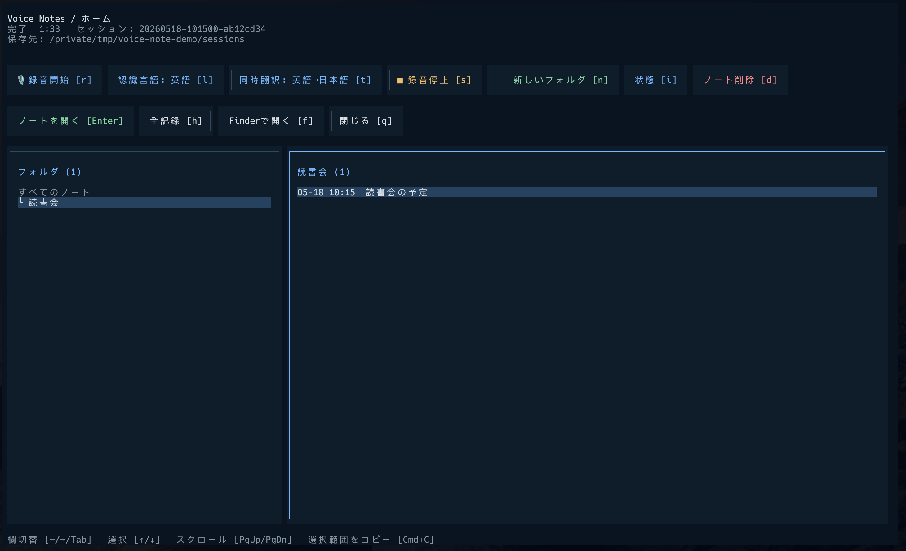
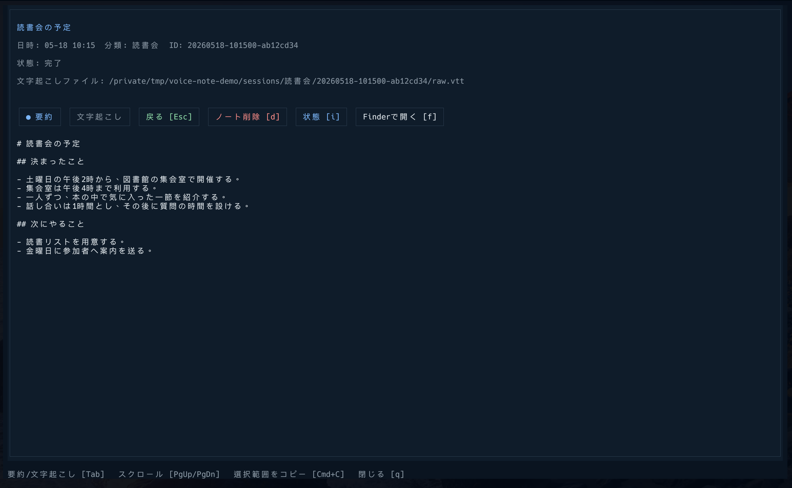

# Voice Notes

Macのマイク音声と再生音を文字起こしし、原文を残したままCodex CLIで修正・要約するターミナルアプリです。
英語の録音では、Appleの内蔵翻訳で原文と日本語訳を並べて表示できます。



画面は架空のデータを使った例です。

## 必要な環境

- macOS 26以降
- [Bun](https://bun.com/docs/installation) 1.3.0以降
- Node.js 26.4.0以降とpnpm
- macOS 26対応のXcode Command Line Tools
- インストール・認証済みの[Codex CLI](https://developers.openai.com/codex/cli)（要約生成の確認版: 0.160.1）

Xcode Command Line Toolsが未導入なら、`xcode-select --install`を実行してください。
録音・翻訳用プログラムは初回利用時にコンパイルします。

「システム設定 → プライバシーとセキュリティ」で、使用するターミナルに次の権限を許可してください。

- マイク
- 画面とシステムオーディオの収録

音声認識データは初回録音時にAppleからダウンロードします。

## インストール

```bash
pnpm add -g @wabi1318/voice-notes
```

## 使い方

任意のフォルダで起動します。

```bash
voice-note
```

1. 保存先のフォルダと認識言語（日本語／英語）を選び、「録音開始 [r]」を押します。
2. 「録音停止 [s]」を押すと、修正した文字起こしと要約を生成します。
3. 処理が終わったノートを選び、「ノートを開く [Enter]」で結果を確認します。



同時に録音できるのは1件です。要約中は次の録音を開始できます。
原文が残っている失敗・中断した記録は、詳細画面の「要約を再実行 [r]」から再処理できます。

## 英語から日本語への同時翻訳

英語・日本語の翻訳言語を「システム設定 → 一般 → 言語と地域 → 翻訳言語」からダウンロードします（[Appleの手順](https://support.apple.com/ja-jp/guide/mac-help/mchldd8b3c15/26/mac/26)）。

録音前に「認識言語: 英語 [l]」と「同時翻訳: 英語→日本語 [t]」を選び、録音を開始します。
録音中は英語の原文と日本語訳を左右に表示します。設定の切り替えは録音停止後に行います。
翻訳に失敗しても、英語の文字起こしは続けます。

## 保存先とデータの扱い

配布パッケージの記録は`~/Library/Application Support/Voice Notes/sessions/`に保存します。
リポジトリを取得して起動する場合は、その中の`sessions/`を使います。

原文・訳文・要約は録音ごとのフォルダへ保存します。「Finderで開く [f]」を押すと保存フォルダを開けます。
原文は修正結果で上書きしません。AIによる修正・要約は原文と照らして確認してください。
パッケージの更新やアンインストールで記録は削除しません。

文字起こしと同時翻訳はMac内で処理します。
修正・要約時には原文を、タイトル生成時には要約をCodex CLIへ送信します。利用条件はCodexの契約に従います。
要約処理にはCodex CLIの既定モデル・接続先を使い、独自の設定は適用しません。

処理待ちの音声を端末内に一時退避する場合がありますが、処理終了・異常終了後に音声ファイルは残りません。

## ライセンス

[MIT License](LICENSE)

保守者: [wabi1318](https://github.com/wabi1318) ／ [問い合わせ](https://github.com/wabi1318/voice-notes/issues)
